_This PR description was written by an AI agent (OpenHands) on behalf of the author._

# 📝 Pull Request

## 🔧 Title:

docs: remove Airtm from site, internal docs, and diagrams

## 🛠️ Issue

- Closes #1750

## 📚 Description

Airtm is not part of the product. The docs site, legal copy, SEO metadata, roadmap, and diagrams still described it as a live provider, which sent readers to a rail that does not exist. This PR removes Airtm from every file owned by #1750 and points the copy at the rails actually in use: Stellar wallets, USDC, Trustless Work escrows, and BlindPay payouts.

No "deprecated Airtm" or migration notes were added: the references are removed and the copy is rewritten.

## ✅ Changes applied

### Site pages

Why: the public legal pages, homepage metadata, and roadmap still named Airtm as the balance, top-up, and withdrawal provider.

- `src/content/terms.mdx` — 3 passages rewritten:
  - §2: "Balance management and fund handling via Airtm integration" → "through Stellar wallets and BlindPay".
  - §6.3: conversion-provider example changed from Airtm to BlindPay.
  - §14: third-party list is now Trustless Work, Stellar network, BlindPay, Supabase.
- `src/content/privacy.mdx` — removed the Airtm `purpose` / `data` / `link` props that were overriding the GitHub processor card. The GitHub card now shows its own purpose ("Public API for fetching contributor and repository data") and its own privacy-policy link. This is a correctness fix: before this PR the GitHub card displayed Airtm's fiat-to-crypto purpose and data.
- `src/app/page.tsx` — removed "Airtm" from the SEO keywords. No visual change.
- `src/components/blueprint/evolution-timeline/evolution-timeline.data.ts` — removed the completed "Airtm provider (fiat on/off ramp, optional)" deliverable from Phase 3.

### Docs (public site)

Why: `/docs/guide/airtm` documented a provider that is not part of the product, and the docs index and LLM feeds still listed it.

- Deleted `content/docs/guide/airtm.mdx` (435 lines).
- Added a permanent redirect in `next.config.ts`: `/docs/guide/airtm` → `/docs/guide/withdrawals`.
- Regenerated the docs search index with `npm run docs:index`: 1,107 entries, no `guide/airtm` entry.
- The `src/app/llms*.txt` routes are generated from the same content, so the deleted page is no longer listed.

### Internal docs

Why: the internal guides, architecture notes, glossary, and project context still described Airtm deposits, payouts, and webhooks.

- Deleted `docs/guides/airtm.md` (347 lines).
- Rewrote Airtm passages in 23 files under `docs/`: `docs/README.md`, `docs/accessibility.md`, `docs/ai-context.md`, `docs/architecture/data-model.md`, `docs/architecture/payment-flows.md`, `docs/architecture/provider-integration.md`, `docs/backend/modules.md`, `docs/business/glossary.md`, `docs/business/product-overview.md`, `docs/guides/architecture.md`, `docs/guides/core-concepts.md`, `docs/guides/deployment.md`, `docs/guides/deposits.md`, `docs/guides/errors-troubleshooting.md`, `docs/guides/events-reference.md`, `docs/guides/marketplace-integration.md`, `docs/guides/npm-packages.md`, `docs/guides/overview.md`, `docs/guides/standards.md`, `docs/guides/withdrawals.md`, `docs/project-context.md`, `docs/standards/naming-conventions.md`, `docs/terms-and-conditions.md`.
- The rewritten text describes the crypto-native flow: USDC deposits to Stellar wallets, Trustless Work escrow, and BlindPay bank payouts.

### Diagrams

Why: the diagram pipeline still generated an Airtm deposit flow, and the withdrawal lifecycle still drew the Airtm state edges.

- Deleted `scripts/diagrams/deposit_airtm_flow.py` (72 lines) and its rendered output `public/diagrams/deposit-airtm-flow.svg` (45 lines).
- Removed `deposit_airtm_flow` from `scripts/diagrams/generate_all.py`.
- Rewrote `scripts/diagrams/withdrawal_lifecycle.py` for the crypto-native rail and re-rendered `public/diagrams/withdrawal-lifecycle.svg`.
- `npm run diagrams` now generates 5 diagrams and leaves the working tree clean, so the committed SVG matches the source.

### Redirect added in `next.config.ts`

```ts
async redirects() {
  return [
    {
      source: "/docs/guide/airtm",
      destination: "/docs/guide/withdrawals",
      permanent: true,
    },
  ];
},
```

```
$ curl -s -o /dev/null -D - http://localhost:12000/docs/guide/airtm
HTTP/1.1 308 Permanent Redirect
location: /docs/guide/withdrawals
```

### Regenerated docs index

```
$ npm run docs:index
Generated search index with 1107 entries from .../content/docs.

$ grep -n "guide/airtm" src/data/docs-index.json
(no output)
```

The regenerated index still contains 109 lines with "airtm" (169 occurrences across 87 index entries) from pages owned by other docs issues (listed at the bottom); the deleted page itself is gone.

## 🧪 Verification

### Grep: no Airtm left in the files this PR touches

```
$ grep -rli airtm docs/ src/content/ src/app/page.tsx src/components/ ROADMAP.md README.md scripts/diagrams/ public/diagrams/
(no output; exit 1)
```

```
$ grep -ni airtm $(cat touched-files.txt)   # 33 existing files changed by this PR
next.config.ts:38:        source: "/docs/guide/airtm",
```

The only remaining hit is the redirect source in `next.config.ts`, which must contain the old path to serve the 308. All other touched files are clean.

### Command results

| Command | Exit | Result |
|---|---|---|
| `npm run lint` | 0 | 2 pre-existing `react-hooks/exhaustive-deps` warnings in `src/hooks/useScrollSpy.ts:153,155` (file untouched by this PR). |
| `npm run lint:classes` | 0 | `No undefined animate-*/shadow-* classes found.` |
| `npm test` | 0 | `Test Files 65 passed (65)`; `Tests 644 passed (644)`; 29.01s. |
| `npm run build` | 0 | `✓ Compiled successfully in 26.0s`; `✓ Generating static pages (79/79)`. |
| `npm run docs:index` | 0 | `Generated search index with 1107 entries`; no `guide/airtm` entry. |
| `npm run diagrams` | 0 | 5 diagrams generated; `git status --short` is clean. |

### CI note

The `Generated diagrams up to date` check fails before it reaches the diagram comparison:

```
E: Version '2.42.2-9ubuntu0.1' for 'graphviz' was not found
```

The workflow pins `graphviz=2.42.2-9ubuntu0.1` (`.github/workflows/ci.yml:77`), but the current Ubuntu 26.04 runner only offers `graphviz-tools`. This is an infrastructure issue on `main`, not a diff from this PR. Locally, with graphviz 2.42.4 and scour 0.38.2, `npm run diagrams` regenerates all 5 diagrams and `git status --short` is clean. The other 6 checks pass (Backend Build, Frontend Build, GitGuardian, OpenAPI staleness, dependency audit, a11y).

## 🔍 Evidence/Media (screenshots/videos)

All screenshots are before/after composites. Each composite is the changed region at 1440px and 390px, in light and dark. Full-page images are in the `pr-1759-screenshots` branch under `screenshots/pr-1759/{base,head}/`.

### `/terms` — §2 Description of Service

| 1440px light | 1440px dark |
|---|---|
| 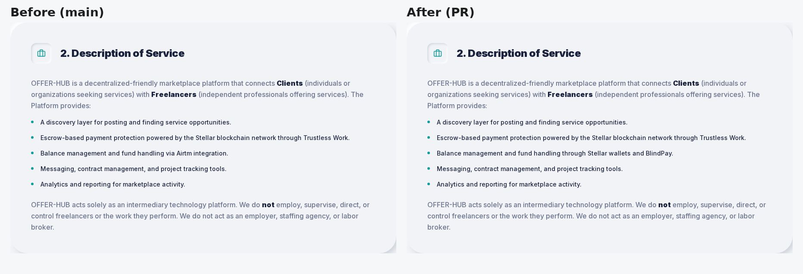 | 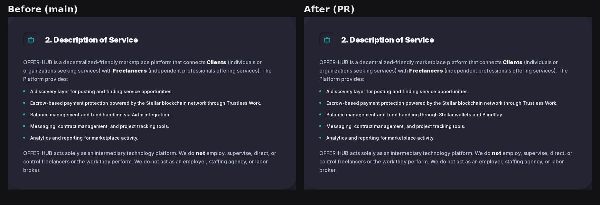 |

| 390px light | 390px dark |
|---|---|
| 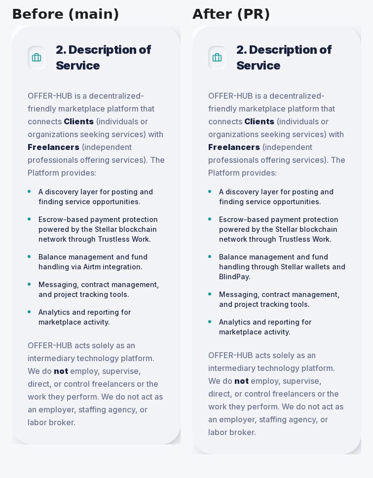 | 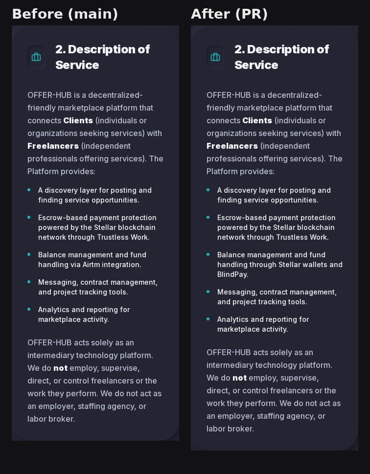 |

Full page (1440px light): [before](https://raw.githubusercontent.com/Emmanuel-Ugochukwu1/offer-hub-monorepo/pr-1759-screenshots/screenshots/pr-1759/base/terms-1440-light.jpg) · [after](https://raw.githubusercontent.com/Emmanuel-Ugochukwu1/offer-hub-monorepo/pr-1759-screenshots/screenshots/pr-1759/head/terms-1440-light.jpg)

### `/privacy` — Third-Party Data Processors

| 1440px light | 1440px dark |
|---|---|
| 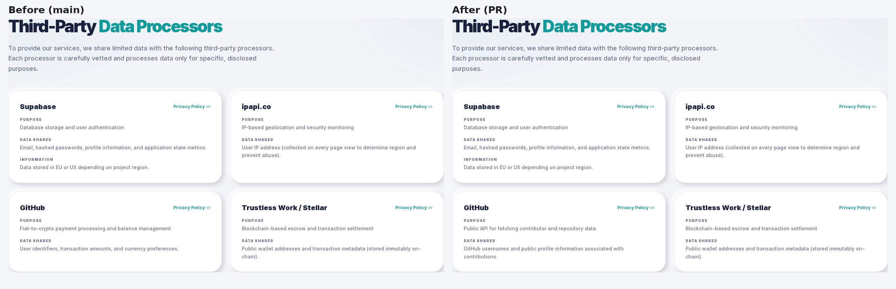 | 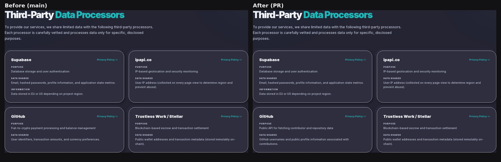 |

| 390px light | 390px dark |
|---|---|
| 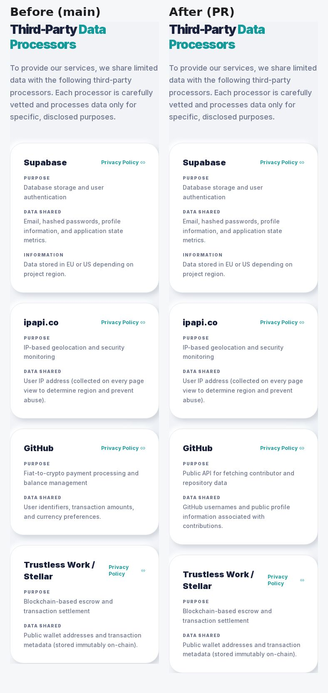 | 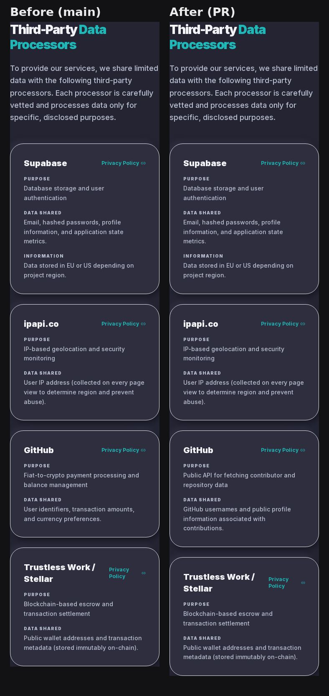 |

Full page (1440px light): [before](https://raw.githubusercontent.com/Emmanuel-Ugochukwu1/offer-hub-monorepo/pr-1759-screenshots/screenshots/pr-1759/base/privacy-1440-light.jpg) · [after](https://raw.githubusercontent.com/Emmanuel-Ugochukwu1/offer-hub-monorepo/pr-1759-screenshots/screenshots/pr-1759/head/privacy-1440-light.jpg)

### `/blueprint` — Phase 3 External Providers (expanded)

| 1440px light | 1440px dark |
|---|---|
| 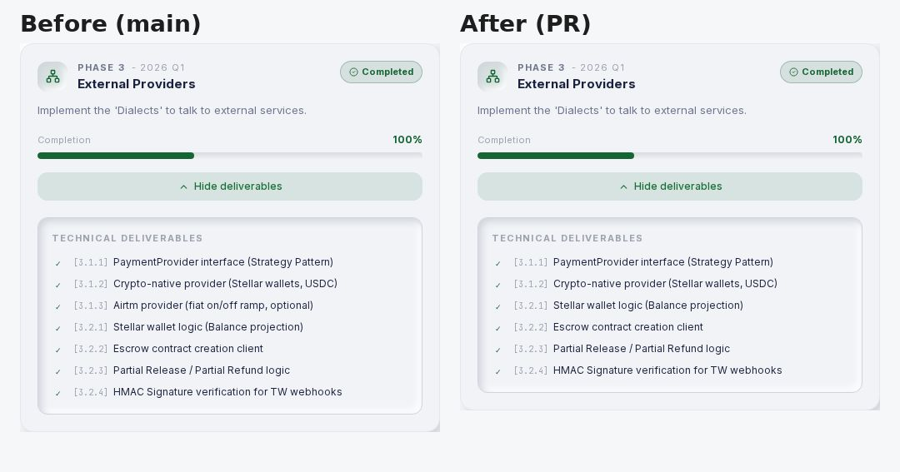 | 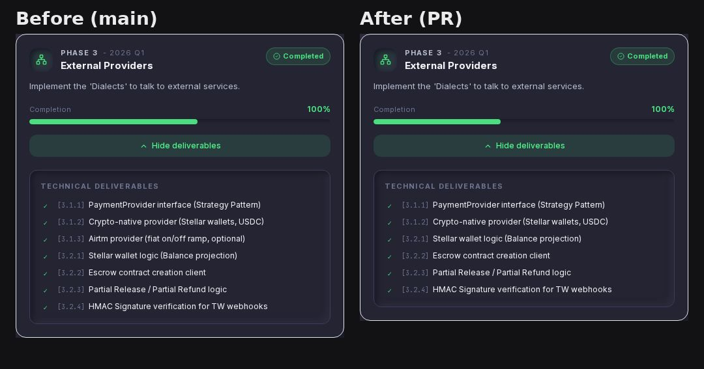 |

| 390px light | 390px dark |
|---|---|
| 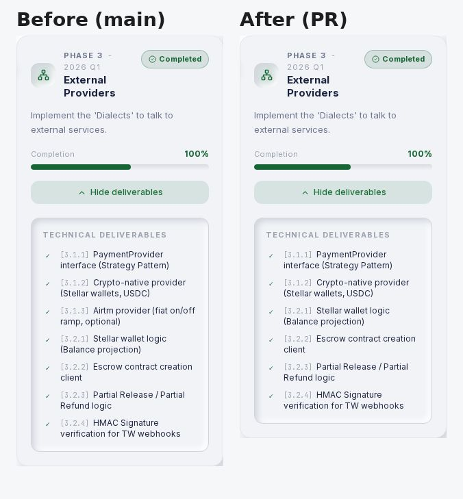 | 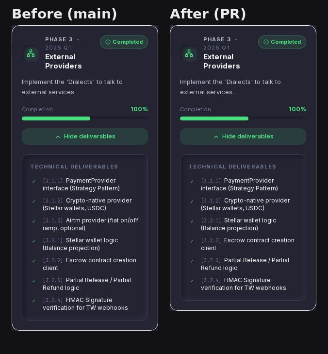 |

### `/docs/guide/withdrawals` — lifecycle diagram

| 1440px light | 1440px dark |
|---|---|
| 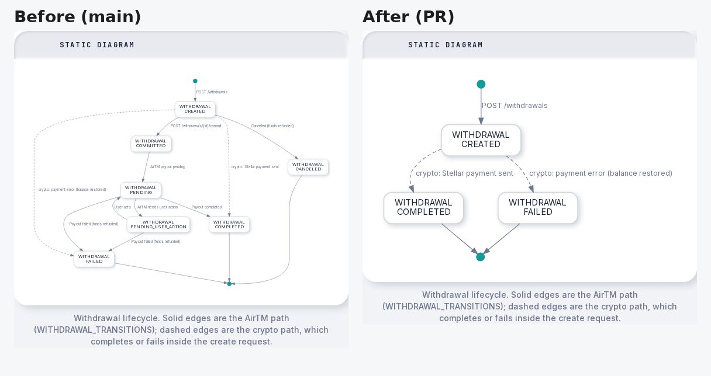 | 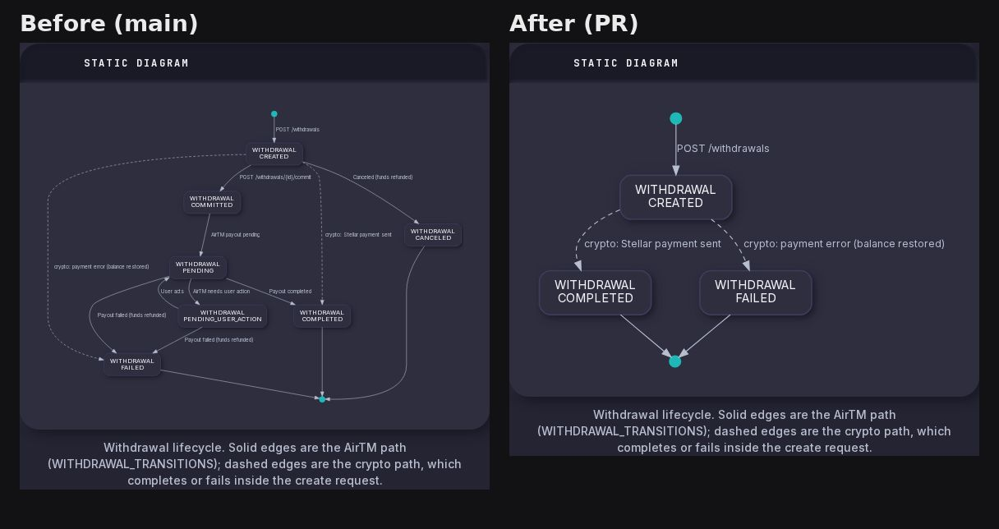 |

| 390px light | 390px dark |
|---|---|
| 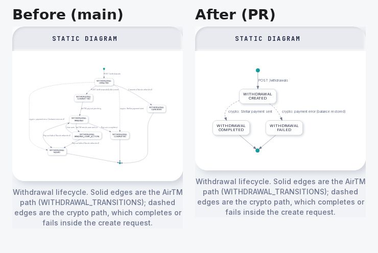 | 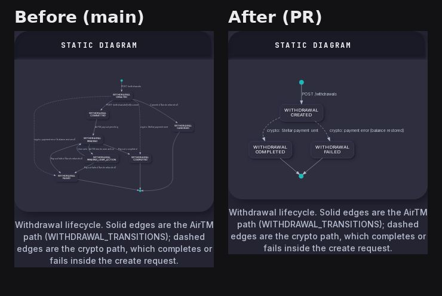 |

Full page (1440px light): [before](https://raw.githubusercontent.com/Emmanuel-Ugochukwu1/offer-hub-monorepo/pr-1759-screenshots/screenshots/pr-1759/base/docs-withdrawals-1440-light.jpg) · [after](https://raw.githubusercontent.com/Emmanuel-Ugochukwu1/offer-hub-monorepo/pr-1759-screenshots/screenshots/pr-1759/head/docs-withdrawals-1440-light.jpg)

### `/docs/guide/deposits` — Airtm deposit diagram

This page is owned by the deposits docs issue, but it still embeds the deleted diagram. The after screenshot shows the current fallback; see "Known issues" below.

| 1440px light | 1440px dark |
|---|---|
| 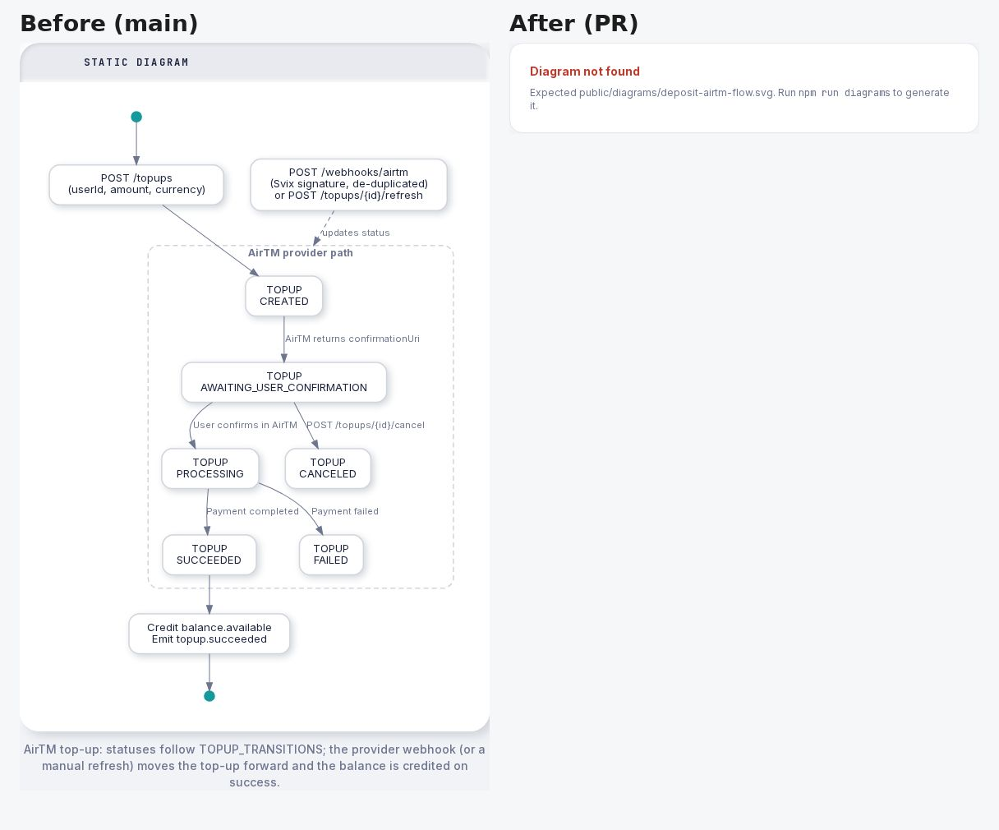 | 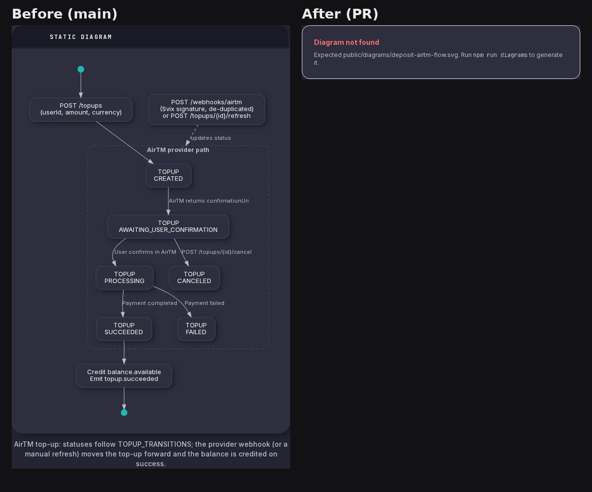 |

| 390px light | 390px dark |
|---|---|
| 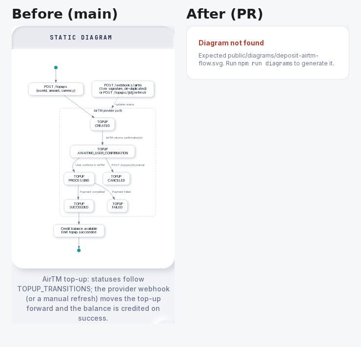 | 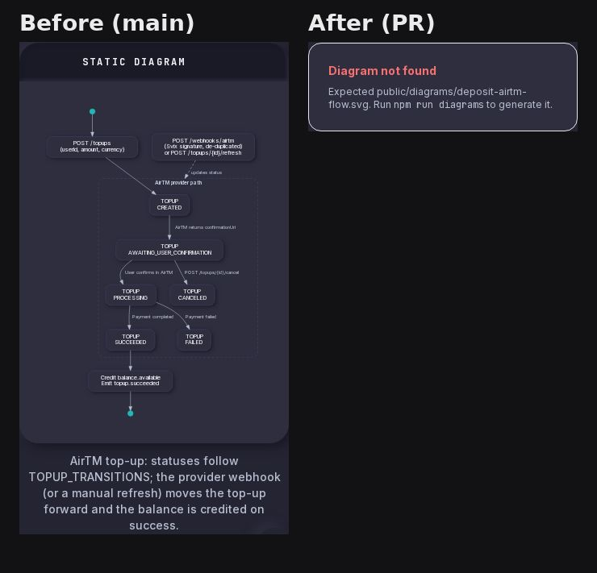 |

Full page (1440px light): [before](https://raw.githubusercontent.com/Emmanuel-Ugochukwu1/offer-hub-monorepo/pr-1759-screenshots/screenshots/pr-1759/base/docs-deposits-1440-light.jpg) · [after](https://raw.githubusercontent.com/Emmanuel-Ugochukwu1/offer-hub-monorepo/pr-1759-screenshots/screenshots/pr-1759/head/docs-deposits-1440-light.jpg)

## ⚠️ Known issues / coordination

- `content/docs/guide/deposits.mdx` still embeds `<StaticDiagram name="deposit-airtm-flow" />`. Because this PR deletes that SVG, `/docs/guide/deposits` now renders the component's "Diagram not found" fallback (see the deposits screenshot). The page is owned by the deposits docs issue. Before merge, either land that rewrite first or remove the one-line reference here.
- `content/docs/guide/withdrawals.mdx` still has the caption "Solid edges are the AirTM path..." while the re-rendered diagram is crypto-only. The page is owned by the withdrawals docs issue; its rewrite should update the caption.
- `src/lib/__tests__/scaffolder-doc.test.ts` still has 3 "airtm" references. It is not in the "Files owned" list and is not assigned to another docs issue, so it needs a follow-up.

## 📄 Files still containing "airtm" (owned by other docs issues)

`content/docs/api-reference/{auth,config-and-health,errors,events,overview,users,wallet-topups,webhooks,withdrawals}.mdx`, `content/docs/configuration.mdx`, `content/docs/installation.mdx`, `content/docs/guide/{background-jobs,build-your-first-marketplace,crypto-native,data-model,deposits,orchestrator,scaffolder,security,self-hosting,state-machines,troubleshooting,trustless-work,wallets,withdrawals}.mdx`, `content/docs/sdk/{errors,quick-start,topups,users,wallet,withdrawals}.mdx`, `public/openapi.json`, `scripts/openapi-source-data.ts`, and the redirect source in `next.config.ts`.
